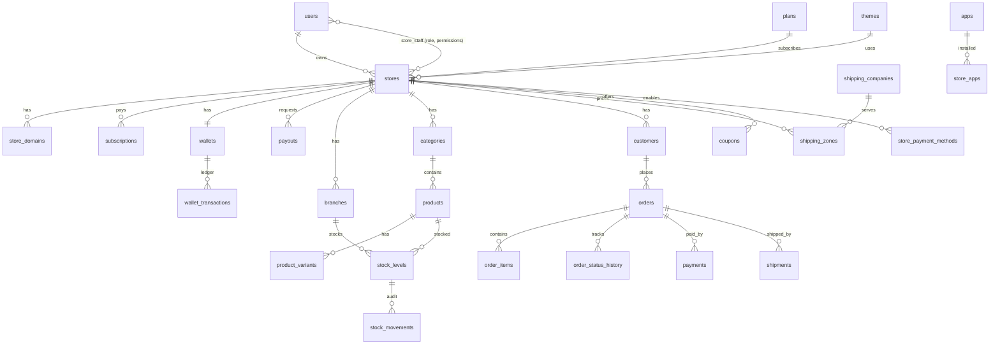

# وثيقة المتطلبات والمعمارية — منصة "مومن" للمتاجر الإلكترونية (SaaS متعددة المستأجرين)

> منصة سودانية لبناء المتاجر الإلكترونية، فكرتها مشابهة لسلة وزد، ومصممة لواقع السوق السوداني:
> بنكك، الدفع عند الاستلام، واتساب، الإنترنت الضعيف، وتقلب سعر الصرف.
> **الحالة:** الأساس (MVP Core) مبني فعلياً في هذا المستودع ومغطّى بـ 22 اختباراً آلياً.

---

## 0. ملخص تنفيذي

| البند | القرار |
|---|---|
| نموذج العمل | اشتراك شهري/سنوي (مجانية / أساسية / احترافية) + عمولة اختيارية لكل باقة على المبيعات |
| التعددية | قاعدة بيانات واحدة مشتركة + عزل بـ `store_id` تلقائي (Global Scope)، مع إمكانية الترحيل لقاعدة لكل متجر للعملاء الكبار لاحقاً |
| الروابط | `slug.platform.sd` (Wildcard) **أو** `platform.sd/s/slug` (يعمل فوراً على أي استضافة) **أو** دومين خاص `shop.com` |
| المكدس | Laravel 13 / PHP 8.3 / MySQL-MariaDB / Blade + Vanilla JS (بدون Build) / PWA |
| الاستضافة الآن | DirectAdmin (استضافة مشتركة أو VPS) — بدون Docker أو Redis أو Node في وقت التشغيل |
| الدفع | COD مطوّر (عربون) + بنكك (mBoK) + تحويل بنكي بإيصال مع فحص الاحتيال + SyberPay (EBS) + طبقة Drivers قابلة للتوسعة |
| التواصل | واتساب أولاً (WhatsApp Cloud API) + SMS محلي للـ OTP كبديل |

---

## 1. المكدس التقني المقترح (Recommended Tech Stack)

### 1.1 لماذا Laravel وليس Node/Next.js أو Microservices؟
1. **DirectAdmin يشغّل PHP أصلاً**: لا تحتاج PM2 ولا Reverse Proxy ولا Docker. ترفع الملفات وتشغّل cron، فيعمل كل شيء.
2. **أرخص تكلفة تشغيل**: استضافة بـ 5–15 دولار شهرياً تكفي لمئات المتاجر في البداية.
3. **سرعة التطوير**: Auth وQueues وScheduler وValidation وORM وStorage كلها مدمجة.
4. **سهولة التوظيف في السودان**: مطوّرو PHP/Laravel متوفرون أكثر بكثير.
5. **Modular Monolith**: الكود مقسّم إلى Services (`Payments`, `Messaging`, `OrderService`, `WalletService`...)، فيمكن فصل أي جزء كخدمة مستقلة لاحقاً عند الحاجة.

### 1.2 الطبقات

| الطبقة | المرحلة 1 (DirectAdmin) | المرحلة 2 (النمو، VPS/Cloud) |
|---|---|---|
| الخلفية | Laravel 13 + PHP 8.3 (OPcache) | نفسها + Laravel Octane (FrankenPHP) |
| قاعدة البيانات | MySQL 8 / MariaDB 10.6+ | MySQL Primary + Read Replica، أو PlanetScale/Vitess |
| الكاش والجلسات | `database`/`file` | Redis |
| الطوابير | `database` queue + cron كل دقيقة | Redis + Horizon (عامل دائم عبر Supervisor) |
| البحث | `LIKE` مع فهارس | Meilisearch (يدعم العربية والتصحيح الإملائي) |
| الواجهات | Blade + CSS مكتوب يدوياً (~10KB) + JS خفيف | نفسها، مع Inertia/Vue للوحة التحكم إن احتجت |
| PWA | Service Worker لكل متجر + Manifest ديناميكي | + Web Push + Background Sync |
| التخزين | `storage/app/public` (صور) و`storage/app/private` (الإيصالات) | Cloudflare R2 / Backblaze B2 (متوافق مع S3) |
| CDN وSSL | Let's Encrypt من DirectAdmin + Cloudflare (مجاني) | Cloudflare for SaaS (SSL تلقائي للدومينات الخاصة) |
| المراقبة | Laravel Log + UptimeRobot | Sentry + Grafana/Prometheus |
| النسخ الاحتياطي | DirectAdmin Backups + `mysqldump` يومي خارجي | Snapshots + Point-in-time recovery |

> **ملاحظة عن مزودي الخدمات السحابية**: بعض المزودين الأمريكيين ما زالوا يقيّدون الحسابات والدفع من السودان.
> نوصي بـ **Hetzner** أو **Contabo** (ألمانيا) أو مزود خليجي، مع **Cloudflare** أمامها. من الأفضل أن تكون الفوترة عبر حساب أو شركة خارج السودان، وراجع شروط كل مزود قبل التعاقد.

### 1.3 لماذا لا نستخدم React/Next.js لواجهة المتجر؟
واجهة المتجر **Server-Rendered HTML** خفيفة جداً. حجم الصفحة الأولى أقل من 40KB قبل الصور، ولا تحتاج JavaScript Bundle لتظهر.
هذا أسرع على شبكات 3G وEDGE في السودان من أي SPA، ومحركات البحث وفيسبوك تقرأ الصفحة مباشرة (SEO و Open Graph).

---

## 2. المخطط الهيكلي لقاعدة البيانات (Database Schema)

### 2.1 استراتيجية التعددية
- **Shared Database + Tenant ID**: كل جدول خاص بمتجر فيه `store_id`.
- الـ Trait `App\Models\Concerns\BelongsToStore`:
  - يضيف `WHERE store_id = ?` تلقائياً لكل استعلام عند وجود متجر نشط.
  - يضع `store_id` تلقائياً عند الإنشاء، ويرمي استثناءً إن لم يوجد متجر نشط (يمنع تسرّب بيانات بلا مالك).
- `App\Support\Tenancy\CurrentStore` يحتفظ بالمتجر الحالي لكل طلب أو Job (مسجّل كـ `scoped`).
- يُحدَّد المتجر **قبل** Route Model Binding (عبر Middleware Priority)، فرابط مثل `/dashboard/products/{id}` لا يصل أبداً لمنتج متجر آخر. هذا مغطّى باختبار في `TenancyTest`.

**متى ننتقل إلى Database-per-tenant؟** للمتاجر الكبيرة جداً (Enterprise) أو عند متطلبات قانونية. التصميم يسمح بذلك لأن كل الوصول يمر عبر `CurrentStore`.

### 2.2 الجداول



| المجال | الجداول | ملاحظات تصميمية |
|---|---|---|
| المنصة (Landlord) | `plans`, `themes`, `stores`, `store_domains`, `store_staff`, `subscriptions`, `exchange_rates`, `apps`, `store_apps` | حدود الباقة (`max_products`, `max_staff`, `max_branches`, `custom_domain`, `commission_rate`) تُفرض في الكود |
| الكتالوج | `categories`, `products`, `product_variants`, `branches`, `stock_levels`, `stock_movements` | المخزون **لكل فرع ولكل Variant**، وكل حركة مسجّلة للتدقيق. المنتج يمكن تسعيره بالدولار (`price_currency`) ويُحوَّل للجنيه آلياً |
| المبيعات | `customers`, `orders`, `order_items`, `order_status_history`, `coupons` | العميل يُعرّف **برقم الهاتف** وليس الإيميل. الطلب يحفظ `ship_landmark` ("جنب الجامع") و`tracking_token` لرابط التتبع العام |
| الدفع | `store_payment_methods`, `payments` | `reference` و`receipt_hash` مفهرسان لكشف الإيصالات المكررة على مستوى **المنصة كلها** |
| الشحن | `shipping_companies`, `shipping_zones`, `shipments` | تسعير بالولاية ثم المدينة ثم الحي (الأدق أولاً) + وزن + مجاني فوق مبلغ + منع COD لمناطق معينة |
| المالية | `wallets`, `wallet_transactions`, `payouts` | دفتر أستاذ غير قابل للتعديل، وكل حركة تحفظ `balance_after` |
| التواصل | `message_logs`, `otp_codes`, `abandoned_carts` | كل رسالة واتساب أو SMS مسجّلة بحالتها |

### 2.3 دورة حياة الطلب
```
pending ──► confirmed ──► processing ──► ready ──► shipped ──► delivered
   │            ▲                                     │
   ▼            │ (تأكيد الإيصال)                       ▼
awaiting_payment ─► payment_review                  returned
   │
   └──► cancelled  (يعيد المخزون تلقائياً)
```

---

## 3. خطة التنفيذ والمراحل (Roadmap & Milestones)

### ✅ المرحلة 0 — الأساس (منجز في هذا المستودع)
- تسجيل التاجر، واختيار الباقة والثيم والرابط، وتجهيز المتجر آلياً (فرع رئيسي، وسائل دفع، منطقة شحن، محفظة).
- تحديد المتجر من الدومين الفرعي أو المسار أو الدومين الخاص، مع التحقق من DNS.
- لوحة التاجر: المنتجات (بسيطة، بخيارات، رقمية)، التصنيفات، المخزون لكل فرع، الطلبات، العملاء، الكوبونات، الشحن والفروع، وسائل الدفع، التصميم (Page Builder)، التقارير والأرباح، المحفظة، الموظفين والصلاحيات (5 أدوار)، الاشتراك، متجر التطبيقات.
- واجهة المتجر: Mobile-first، دفع بخطوة واحدة مع حساب السعر لحظياً، تتبع الطلب، رفع الإيصال، PWA مع Offline.
- الدفع: COD مع عربون، بنكك وتحويل بنكي بإيصال وفحص التكرار، SyberPay (هيكل جاهز)، تأكيد يدوي بنقرة واحدة.
- الشحن: تسعير حسب المنطقة، مناديب مواتر وركشات وبصات، إصدار بوليصة شحن مطبوعة، مبلغ التحصيل.
- واتساب: إشعار الطلب للعميل والتاجر، تغيير الحالة، تأكيد أو رفض الدفع، تنبيه المخزون، تذكير السلة المتروكة، OTP.
- لوحة المنصة: المتاجر، الاشتراكات (تفعيل بالإيصال)، الباقات، الثيمات، طلبات السحب، أسعار الصرف، شركات الشحن العامة.

### المرحلة 1 — MVP للإطلاق التجريبي (4–6 أسابيع)
| الأسبوع | المخرجات |
|---|---|
| 1 | النشر على DirectAdmin، Wildcard DNS وSSL، تفعيل WhatsApp Cloud API وقوالب الرسائل المعتمدة من Meta |
| 2 | 3 ثيمات احترافية (أزياء، عطور، إلكترونيات)، ضغط الصور تلقائياً لـ WebP وتصغيرها |
| 3 | الربط الفعلي مع SyberPay (بيئة الاختبار ثم الإنتاج)، وربط مزود SMS محلي |
| 4 | Onboarding لـ 10–20 تاجر تجريبي، ومتابعة يومية للأخطاء |
| 5–6 | إصلاحات، صفحات قانونية (الشروط والخصوصية)، دليل استخدام فيديو بالعربية |

### المرحلة 2 — النسخة الكاملة (الشهر 2–4)
- **تطبيق "مُطابِق بنكك"** (Android companion): يقرأ إشعارات الإيداع من هاتف التاجر ويطابقها آلياً مع الطلبات (المبلغ + رقم الطلب في التعليق)، فيؤكد الدفع **دون تدخل يدوي**.
- قراءة الإيصال آلياً (OCR) لاستخراج المبلغ ورقم العملية والتاريخ ومقارنتها بالطلب.
- تأكيد الدفع **من واتساب مباشرة**: التاجر يرد "تأكيد 10023" فيتأكد الطلب.
- API عام (REST + Webhooks) وتوثيق للمطورين لمتجر التطبيقات.
- تكامل API مع شركات التوصيل التي توفر واجهات برمجية.
- Meilisearch للبحث، وRedis للكاش والطوابير.
- تقارير متقدمة (تصدير Excel)، ونقاط ولاء، وبطاقات هدايا، وعروض "اشتر 2 واحصل على 1".
- تطبيق موبايل للتاجر (Flutter) لإدارة الطلبات والإشعارات.

### المرحلة 3 — التوسع (الشهر 5+)
- Marketplace موحد يعرض كل متاجر المنصة.
- نقطة بيع (POS) للفروع مرتبطة بنفس المخزون.
- تمويل التجار من رصيد المحفظة، ودفع لاحق.
- التوسع لدول الجوار (تشاد، جنوب السودان، إريتريا) بعملات متعددة.

---

## 4. تصميم تجربة الدفع (بنكك وMBOK) والشحن المحلي

### 4.1 المبدأ
لا توجد حالياً واجهة برمجية عامة لبنكك (mBoK) تسمح بـ Checkout آلي للتجار. لذلك صممنا **نموذجاً هجيناً** يعمل اليوم، وفيه **نقاط ربط جاهزة للأتمتة** عند توفر أي API رسمي.

### 4.2 تدفق الدفع عبر بنكك (مبني فعلياً)
```
العميل يؤكد الطلب
   │
   ▼
صفحة التتبع تعرض: المبلغ بالضبط + رقم حساب التاجر (زر نسخ) + اسم الحساب + "اكتب في التعليق: طلب 10023"
   │
   ▼
العميل يحوّل من تطبيق بنكك ← يرفع Screenshot + رقم العملية
   │
   ▼
ReceiptVerifier (آلياً):
   ├─ حفظ الإيصال في تخزين خاص (ليس public)
   ├─ SHA-256 للصورة ← هل رُفعت هذه الصورة من قبل في أي متجر؟  ⚠️ duplicate_image
   ├─ رقم العملية ← هل استُخدم من قبل في المنصة؟                ⚠️ duplicate_reference
   └─ حالة الطلب ← payment_review
   │
   ▼
واتساب للتاجر: "💳 إيصال جديد للطلب #10023 — المبلغ — رقم العملية — ⚠️ تحذيرات" + رابط مباشر
   │
   ▼
التاجر أو المحاسب يفتح الطلب ← يرى الصورة والتحذيرات ← [✓ تأكيد] أو [رفض + سبب]
   │
   ├─ تأكيد ← paid + confirmed + قيد في المحفظة + واتساب للعميل "✅ تم تأكيد الدفع"
   └─ رفض   ← awaiting_payment + واتساب للعميل بالسبب ورابط إعادة الرفع
```
- **Idempotent**: الضغط على "تأكيد" مرتين لا يكرر القيد المالي (مختبر).
- **أمان**: الإيصالات في `storage/app/private`، ولا تُعرض إلا لموظف المتجر المخوّل (صلاحية `payments`).

### 4.3 مستويات أتمتة بنكك (خارطة طريق)
| المستوى | الآلية | الحالة |
|---|---|---|
| L0 | رفع الإيصال + مراجعة يدوية + فحص التكرار | ✅ مبني |
| L1 | تأكيد من واتساب برد نصي ("تأكيد 10023") | Webhook جاهز في `WebhookController@whatsapp` |
| L2 | OCR يستخرج المبلغ والرقم ويقارنهما بالطلب، ويعتمد آلياً إذا تطابقت الثقة | المرحلة 2 |
| L3 | تطبيق Android يقرأ إشعارات الإيداع في هاتف التاجر ويرسلها للمنصة للمطابقة الآلية | المرحلة 2 (بموافقة التاجر) |
| L4 | API رسمي من بنك الخرطوم (Merchant/QR) | يُضاف كـ Driver جديد دون تعديل باقي النظام |

### 4.4 الدفع عند الاستلام (COD) المطوّر
- **العربون**: يحدد التاجر مثلاً "طلبات فوق 100,000 ج.س تتطلب عربون 20%". يدفعه العميل عبر بنكك من صفحة التتبع قبل الشحن، فتنخفض الطلبات الوهمية بشكل كبير.
- **منع COD لمناطق معينة**: علامة `cod_allowed` على كل منطقة شحن.
- **رسالة تأكيد واتساب** فور الطلب مع رابط التتبع، فيعرف العميل أن الطلب حقيقي.
- **مبلغ التحصيل** يظهر على بوليصة الشحن. عند "تم التوصيل" يُعتبر الطلب مدفوعاً ويُسجَّل في الدفتر.
- **سجل العميل** (عدد طلباته السابقة) يظهر للتاجر لتقييم الثقة. **لاحقاً**: قائمة سوداء مشتركة على مستوى المنصة للأرقام التي ترفض الاستلام.

### 4.5 SyberPay والبوابات الإلكترونية (EBS)
- `App\Services\Payments\Drivers\SyberPay`: يطلب رابط الدفع، يحوّل العميل إليه، ثم Callback على `/webhooks/syberpay/{store}`.
- **لا نثق في الـ Redirect أبداً**: نعيد الاستعلام من البوابة عن حالة العملية قبل التأكيد.
- أي بوابة جديدة (فوري، أوكاش، بطاقات EBS، Cashi...) تُضاف بـ class واحد يرث `PaymentDriver` وسطر في `config/platform.php`.
- ⚠️ أسماء الـ Endpoints وطريقة الـ Hash يجب مطابقتها مع الوثيقة التي يسلّمها مزود البوابة عند التعاقد.

### 4.6 المحفظة والعمولات
- البيع عبر بنكك أو COD: المال يصل **مباشرة للتاجر**. الدفتر يسجّل `sale` ثم `collected_directly` ثم `commission`، فيصبح الرصيد سالباً بقيمة العمولة المستحقة للمنصة، وتُحصَّل مع التجديد.
- البيع عبر بوابة تحصّل لحساب المنصة: الرصيد موجب، والتاجر يطلب السحب، والمدير يحوّل ويسجّل رقم العملية.

### 4.7 الشحن المحلي
| الحاجة | الحل في النظام |
|---|---|
| أسعار مختلفة داخل الخرطوم (أم درمان ≠ بحري ≠ الكدرو) | مناطق بثلاث مستويات، والأدق يُطبَّق أولاً |
| مواتر وركشات | نوع الشركة `motorcycle` و`rickshaw` + اسم المندوب ورقمه في الشحنة، يُرسَلان للعميل على واتساب |
| الولايات (بورتسودان، مدني...) | نوع `bus_cargo` (الشحن بالبصات السفرية) + رابط تتبع مخصص `{tracking}` |
| الاستلام من الفرع | `fulfillment = pickup` بلا رسوم شحن، وقائمة الفروع المتاحة للاستلام |
| بوليصة الشحن | صفحة طباعة A6 فيها رقم البوليصة والعنوان والعلامة المميزة ومبلغ التحصيل |
| عناوين غير منظمة | حقل "علامة مميزة" + الحي كنص حر + زر اتصال وواتساب للمندوب |

---

## 5. المخاطر التقنية والتشغيلية وحلولها

| # | الخطر | الأثر | الحل |
|---|---|---|---|
| 1 | **انقطاع الإنترنت وبطؤه** | ارتداد العملاء | PWA مع Service Worker (Cache-first للأصول وNetwork-first للصفحات + صفحة Offline)، وCSS أقل من 10KB، وصور Lazy، وبلا JS Framework، وCloudflare CDN |
| 2 | **انقطاع الكهرباء والاتصالات** عند التاجر | تأخر تأكيد الطلبات | موظفون متعددون بصلاحيات (محاسب، مسؤول شحن)، وكل الإشعارات عبر واتساب الذي يعمل على أي شبكة |
| 3 | **إيصالات بنكك المزورة أو المكررة** | خسارة مالية | SHA-256 للصورة + فحص رقم العملية على مستوى المنصة + تحذير واضح للتاجر + (لاحقاً) OCR ومطابقة إشعارات البنك |
| 4 | **طلبات COD وهمية** | تكلفة شحن ضائعة | عربون إلزامي فوق حد معين، منع COD لمناطق، رسالة تأكيد واتساب، سجل العميل، وقائمة سوداء مشتركة لاحقاً |
| 5 | **تقلب سعر الصرف** | أسعار خاطئة | تسعير المنتج بالدولار مع تحويل آلي بسعر يحدده المدير (`exchange_rates`)، وسعر الطلب **يُثبَّت** لحظة الشراء في `order_items.unit_price` |
| 6 | **تكلفة واتساب Cloud API** | ارتفاع التكلفة مع النمو | رسائل الخدمة داخل نافذة 24 ساعة مجانية، وقوالب Utility رخيصة، وروابط `wa.me` كبديل مجاني، وباقة "واتساب المتقدم" كتطبيق مدفوع |
| 7 | **حظر أو تقييد مزودي الخدمات للسودان** | توقف الخدمة | استضافة أوروبية أو خليجية + Cloudflare + نسخ احتياطية خارجية + Drivers قابلة للتبديل لكل مزود (SMS وواتساب والدفع) |
| 8 | **تسرّب بيانات بين المتاجر** | كارثي | Global Scope إجباري + `store_id` يُفرض عند الإنشاء + الـ Tenant يُحدَّد قبل Route Binding + اختبارات عزل آلية |
| 9 | **ضعف الاستضافة المشتركة مع النمو** | بطء | الطوابير لا توقف الـ Checkout، وكاش لتحديد المتجر (5 دقائق)، وفهارس على `(store_id, status)` و`(store_id, created_at)`، والانتقال لـ VPS وRedis دون تغيير الكود |
| 10 | **الدومينات الخاصة وSSL** | تعقيد تشغيلي | التحقق بـ CNAME أو TXT، و SSL تلقائي عبر Cloudflare for SaaS (أو Let's Encrypt من DirectAdmin لكل دومين في البداية) |
| 11 | **ثقة العميل في الشراء أونلاين** | انخفاض التحويل | زر واتساب في كل صفحة، رابط تتبع شفاف، اسم الحساب البنكي ظاهر، سياسة استرجاع، و"مدعوم بواسطة المنصة" |
| 12 | **الامتثال والضرائب** | مخاطر قانونية | سجل تدقيق لكل حركة مالية ومخزنية، فواتير قابلة للطباعة، وجاهزية لإضافة ضريبة القيمة المضافة كحقل في الطلب |
| 13 | **فقدان البيانات** | كارثي | نسخ DirectAdmin اليومية + `mysqldump` مشفر إلى تخزين خارجي (R2 أو B2) + اختبار استرجاع شهري |

---

## 6. الأمن والصلاحيات

| الدور | الصلاحيات |
|---|---|
| owner (المالك) | كل شيء |
| manager (مدير) | المنتجات، الطلبات، العملاء، الكوبونات، الشحن، التقارير، الدفع، التصميم |
| staff (موظف) | المنتجات، الطلبات |
| accountant (محاسب) | الطلبات، الدفع، التقارير، المحفظة |
| shipping (مسؤول شحن) | الطلبات، الشحن |

- كلمات المرور Bcrypt، وتسجيل دخول بالـ OTP عبر واتساب (Rate-limited: 3 رسائل كل 10 دقائق و5 محاولات للرمز).
- CSRF على كل النماذج (عدا الـ Webhooks)، وThrottling على الدخول والتسجيل والدفع ورفع الإيصالات.
- الإيصالات والملفات الرقمية في تخزين خاص.
- لا يُخزَّن أي بيانات بطاقات (PCI) لأن البوابات Hosted.

---

## 7. هيكل الكود

```
app/
├── Models/Concerns/BelongsToStore.php     ← قلب العزل بين المتاجر
├── Support/Tenancy/CurrentStore.php       ← المتجر الحالي
├── Http/Middleware/
│   ├── IdentifyStore.php                  ← subdomain / custom domain / path
│   ├── MerchantContext.php                ← المتجر النشط في اللوحة + RBAC
│   └── SuperAdmin.php
├── Services/
│   ├── Payments/ (PaymentDriver, PaymentManager, PaymentService, ReceiptVerifier, Drivers/*)
│   ├── Messaging/ (WhatsApp, Sms, OtpService, Notifier)
│   ├── OrderService.php  CartService.php  InventoryService.php
│   ├── ShippingCalculator.php  WalletService.php
│   └── StoreProvisioner.php  SubscriptionService.php
├── Http/Controllers/{Dashboard,Admin,Storefront}/*
routes/web.php          ← المنصة + لوحة التاجر + المدير + Webhooks
routes/storefront.php   ← واجهة المتجر (تُحمَّل مرتين: host mode و path mode)
config/platform.php     ← الدومين، الأدوار، الولايات والمدن، Drivers الدفع، إعدادات الثيم
config/messaging.php    ← واتساب، SMS، SyberPay
```
